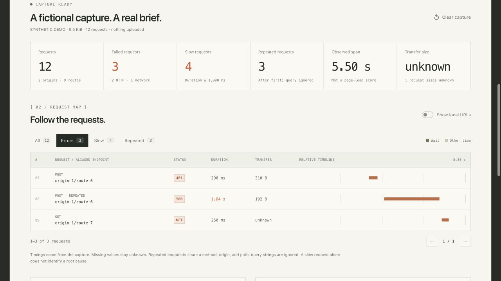

# Tracebrief

### Network evidence for your next debugging conversation.

Turn a browser HAR capture into a concise report for a teammate, a GitHub issue, or an AI coding assistant. Tracebrief preserves request order, errors, timing, and repeated routes, then builds a new report using opaque endpoint aliases. Original URLs, headers, cookies, and payloads are excluded.

**Local browser app + CLI · zero third-party packages · no account or API key · MIT**

**Languages:** [English](README.md) · [Tiếng Việt](README.vi.md) · [한국어](README.ko.md) · [日本語](README.ja.md) · [Español](README.es.md) · [Português](README.pt-BR.md) · [简体中文](README.zh-CN.md) · [ไทย](README.th.md) · [Français](README.fr.md)

[Privacy contract](docs/PRIVACY.md) · [Alternatives](docs/COMPARISON.md) · [Contributing](CONTRIBUTING.md)

**[Try the live demo](https://hieunguyenak92.github.io/tracebrief/)**



## Built for the handoff

- **Building with an AI assistant?** Give it a small Markdown trace to reason about HTTP failures and request timing. Review it before sending it to any service.
- **Debugging a frontend?** Inspect slow requests and repeated routes in a local waterfall, then hand a teammate the same metadata.
- **Helping someone reproduce a bug?** Export a readable HTML report that opens without installing Tracebrief. Use a synthetic capture for public issues.

HAR is the network log your browser's developer tools can export. Try the included fictional capture first; you do not need your own file to explore the tool.

## Try it

Requires **Node.js 22 or later**. From a checkout:

```sh
git clone https://github.com/hieunguyenak92/tracebrief.git
cd tracebrief
npm run dev
```

Open **http://localhost:4173**, choose the synthetic demo, or drop a `.har` file into the page. Review the waterfall and export a report. There are no dependencies to install.

For a single file that you can open without a server:

```sh
npm run build
```

Open `dist/index.html` in your browser. Keep a trusted local copy when working with private captures. The original HAR stays on your device; the app does not upload it or store it between page loads.

## What you get

- A request waterfall with filters for HTTP/network errors, requests taking at least one second, and duplicate requests.
- Counts of discarded data categories, so you can see what the export leaves out.
- Markdown for an issue or an AI coding assistant, a standalone HTML report, and reconstructed HAR metadata. The CLI also exports JSON metadata.
- A shared analysis core for the browser and CLI. Unknown measurements remain unknown.

“Duplicate” means the same method, origin, and path after the first occurrence; query strings are ignored for grouping. Repeated requests may be intentional. A slow request is an observation, not a root-cause diagnosis.

## What is shared

Tracebrief **builds a new report from permitted metadata**. It does not edit the original file and try to guess which strings are secrets.

| Kept | Omitted or replaced |
| --- | --- |
| Request order, relative start, duration, wait and receive times | Absolute dates become offsets; reconstructed HAR dates start at 1970-01-01 |
| Valid status codes, byte sizes, standard methods, fixed content categories | Original URL, host, path, query and fragment become opaque origin/route aliases |
| Grouping by origin and route | Headers, cookies, request/response bodies and custom fields are omitted |

For example, a URL is exported as `https://origin-1.invalid/route-2`. Aliases only connect requests within that analysis; they are not meaningful endpoint names. Original URLs can be shown by an explicit **local viewing** toggle and never enter an export.

**Review every export.** Timing, sizes, status codes and patterns of requests can still be sensitive. Tracebrief does not guarantee the absence of personal information and does not make a capture anonymous. A reconstructed HAR cannot replay the session or diagnose payload/authentication problems. See the full [privacy contract](docs/PRIVACY.md).

## CLI

No server and no network access:

```sh
node bin/tracebrief.js public/samples/demo.har --format markdown
node bin/tracebrief.js capture.har --format html --output report.html
node bin/tracebrief.js capture.har --format har --output reconstructed.har
node bin/tracebrief.js capture.har --format json --output metadata.json
```

The default format is Markdown, written to standard output. Use `--help` for options. Existing output files are not overwritten; choose a new path. Keep private captures outside your checkout.

## Capture a HAR

1. Open your browser's developer tools and the Network panel.
2. Reproduce the problem, then use the panel's HAR export command.
3. Open the saved capture in a trusted local copy of Tracebrief.
4. Inspect the report, check what was discarded, then review the exported file before sending it.

Chrome already has a sanitized HAR export that excludes certain sensitive headers. Tracebrief adds a deliberately narrower sharing view by also discarding original endpoints and bodies. Full captures can contain credentials and personal data; see [Chrome's Network reference](https://developer.chrome.com/docs/devtools/network/reference) and the [comparison](docs/COMPARISON.md).

## Limits

- Up to **50 MiB** of HAR JSON and **20,000 entries** per capture.
- Only valid, bounded numeric metadata is retained. Missing or invalid fields are flagged or marked unknown.
- No live capture, replay, cross-capture alias mapping, or automatic explanation of why a request failed.
- Removing endpoints and bodies sacrifices debugging detail. Use DevTools or a trusted private debugging channel when you need that information.
- Version 0.1 is an initial release. Browser and operating-system combinations beyond the recorded verification need feedback.

Reconstructed HAR files include Tracebrief annotations to preserve unknown values and original measurements. Generic HAR viewers may show placeholder timing/status fields. Use Markdown, HTML, or JSON when exact interpretation of unknown measurements matters; see [privacy details](docs/PRIVACY.md).

## Development

```sh
npm test
npm run lint
npm run build
```

Source layout: `public/core.js` holds analysis and exporters; `public/app.js` holds browser interactions; `bin/tracebrief.js` is the CLI. Build and development scripts use Node's standard library.

Please send a minimal **synthetic** reproduction when reporting a bug. Never attach a production HAR, access token, customer payload, or private endpoint to a public issue. [Contribution guide](CONTRIBUTING.md) · [Security policy](SECURITY.md).

## License

[MIT](LICENSE).
